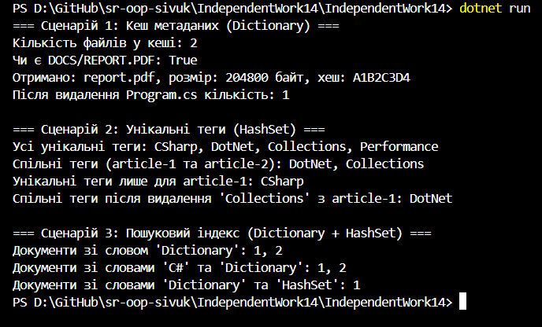

# Самостійна робота №14 — Вивчення `Dictionary<TKey, TValue>` та `HashSet<T>` у бібліотеках .NET

## Структура проєкту
- `FileMetadata.cs` / `FileMetadataCache.cs` — реалізація кешу метаданих файлів на базі `Dictionary<string, FileMetadata>`.
- `TagManager.cs` — система керування унікальними тегами статей на базі `Dictionary<string, HashSet<string>>` з використанням операцій множин (`UnionWith`, `IntersectWith`, `ExceptWith`).
- `SearchIndex.cs` — інвертований пошуковий індекс на базі `Dictionary<string, HashSet<int>>`.
- `Program.cs` — демонстрація роботи всіх трьох сценаріїв.

---

## Приклад виводу програми

## Відповіді на контрольні запитання

### 1. Які переваги generic-колекцій над неузагальненими структурами даних у .NET?
- **Типобезпека на етапі компіляції:** компілятор перевіряє типи елементів під час збірки проєкту, що виключає помилки `InvalidCastException` під час виконання (на відміну від `Hashtable` чи `ArrayList`, які працюють із типом `object`).
- **Відсутність boxing/unboxing:** при зберіганні значимих типів (`int`, `double`, `DateTime`, `struct`) не відбувається пакування в об'єкт у купі, що економить пам'ять і зменшує навантаження на збирач сміття (GC).
- **Вища продуктивність та читабельність:** не потрібно виконувати явне приведення типів при читанні елементів із колекції.

### 2. У яких сценаріях доцільніше використовувати `Dictionary<TKey, TValue>`, а в яких — `HashSet<T>`?
- **`Dictionary<TKey, TValue>`** використовується, коли між даними є асоціативний зв'язок «ключ → значення» і потрібно за унікальним ключем отримати пов'язаний об'єкт (наприклад, за ID користувача отримати його профіль, або за шляхом до файлу — його метадані).
- **`HashSet<T>`** використовується, коли потрібна лише множина унікальних елементів без прив'язаних значень, а головними операціями є перевірка наявності елемента (`Contains`), видалення дублікатів або теоретико-множинні операції (перетин, об'єднання, різниця).

### 3. Як `IEqualityComparer<T>` впливає на коректність і продуктивність `Dictionary` та `HashSet`?
- **Вплив на коректність:** `IEqualityComparer<T>` визначає правила порівняння об'єктів на рівність (`Equals`) та обчислення їхнього хеш-коду (`GetHashCode`). Це дозволяє адаптувати логіку унікальності під бізнес-вимоги — наприклад, ігнорувати регістр рядків (`StringComparer.OrdinalIgnoreCase`) або порівнювати складні об'єкти лише за певним полем (наприклад, `Id` або `Email`).
- **Вплив на продуктивність:** якісна функція `GetHashCode()` рівномірно розподіляє елементи по бакетах хеш-таблиці, підтримуючи складність пошуку $O(1)$. Якщо `GetHashCode()` повертає однакове значення для різних об'єктів, виникають колізії, і пошук деградує до лінійного перебору $O(n)$.

### 4. Чому інвертований індекс зручно будувати саме на базі `Dictionary<string, HashSet<int>>`?
- **Миттєвий пошук слова:** `Dictionary<string, ...>` знаходить запис для шуканого слова за час $O(1)$ незалежно від загального обсягу словника.
- **Автоматична унікальність ID документів:** якщо одне й те саме слово зустрічається в документі №1 десять разів, `HashSet<int>` збереже `docId = 1` лише один раз без додаткових перевірок.
- **Ефективний пошук за кількома словами (AND-запити):** `HashSet<int>` має вбудований метод `IntersectWith()`, який швидко знаходить перетин множин документів для кількох слів, починаючи з найменшої множини.