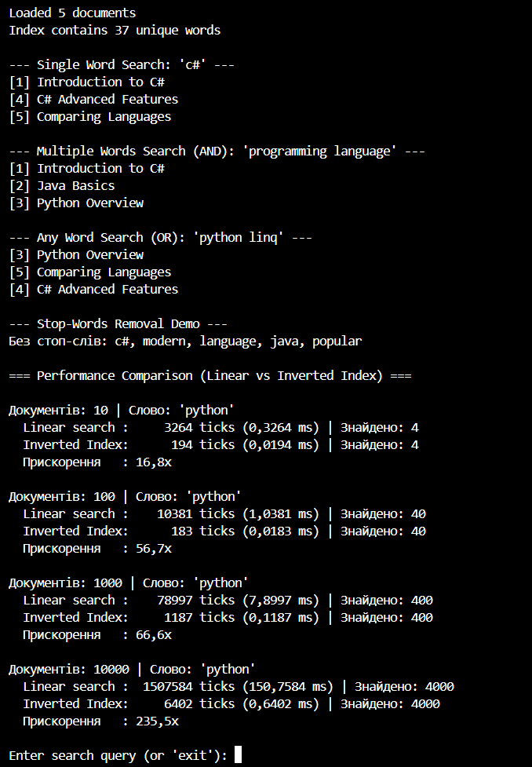

# Самостійна робота №16 — Колекції в практиці ООП: інвертований індекс і вимірювання продуктивності

## Структура проєкту
- `Document.cs` — модель документа (`Id`, `Title`, `Content`).
- `TextProcessor.cs` — утиліти для токенізації тексту, нормалізації регістру та фільтрації стоп-слів.
- `InvertedIndex.cs` — реалізація інвертованого індексу на базі `Dictionary<string, HashSet<int>>` із підтримкою пошуку за одним словом (`SearchSingleWord`), за всіма словами (`SearchMultipleWords` — AND) та за будь-яким зі слів (`SearchAnyWord` — OR).
- `PerformanceTest.cs` — генератор тестових колекцій документів і бенчмарк порівняння лінійного пошуку з пошуком через інвертований індекс (`Stopwatch`).
- `Program.cs` — демонстрація пошуку, вимірювання продуктивності та інтерактивний консольний пошук.
- `REPORT.md` — звіт із описом реалізації, таблицею вимірювань продуктивності та висновками.

---

## Приклад виводу програми

---

## Відповіді на контрольні запитання

### 1. Чому структура `Dictionary<string, HashSet<int>>` добре підходить для реалізації інвертованого індексу?
- **Пошук слова за $O(1)$:** `Dictionary<string, ...>` використовує хеш-таблицю, завдяки чому знаходить запис для будь-якого слова за константний час незалежно від розміру словника.
- **Автоматична дедуплікація ID документів:** якщо слово зустрічається в одному документі кілька разів, `HashSet<int>` зберігає його `Id` лише один раз без необхідності додаткової перевірки `Contains` перед додаванням.
- **Швидкий доступ до самих документів:** у парі зі словником `_documents` (`Dictionary<int, Document>`) отримані ідентифікатори миттєво перетворюються на об'єкти `Document` за $O(1)$.

### 2. Які переваги `HashSet<T>` дає під час обчислення AND/OR-пошуку за кількома словами?
- **Вбудовані теоретико-множинні операції:** `IntersectWith()` реалізує логічне **AND** (залишає лише ID документів, що є в усіх множинах), а `UnionWith()` реалізує логічне **OR** (об'єднує ID документів з усіх множин).
- **Висока ефективність ($O(N)$ замість $O(N \cdot M)$):** перетин або об'єднання двох `HashSet<int>` виконується за лінійний час відносно розміру множин, оскільки перевірка належності елемента в хеш-множині займає $O(1)$. У звичайних списках `List<int>` ця операція вимагала б вкладених циклів або попереднього сортування.

### 3. Чому під час вимірювання продуктивності важливо однаково нормалізувати текст для лінійного пошуку та пошуку через індекс?
- **Коректність порівняння результатів:** якщо індекс приводить слова до нижнього регістру та прибирає розділові знаки (`"C#,"` $\rightarrow$ `"c#"`), а лінійний пошук шукає точний підрядок без токенізації, обидва методи повернуть різну кількість документів, і порівняння швидкості втратить сенс.
- **Чесність вимірювання накладних витрат:** у лінійному пошуку токенізація та нормалізація тексту виконуються під час кожного запиту, тоді як в інвертованому індексі ця робота виконується один раз на етапі індексації. Однакові правила токенізації гарантують, що обидва алгоритми вирішують ідентичну задачу.

### 4. Які обмеження має проста реалізація інвертованого індексу без ранжування, стемінгу та підтримки фраз?
- **Відсутність ранжування релевантності (TF-IDF / BM25):** документи повертаються у довільному порядку (порядку додавання в `HashSet`), а не за ступенем відповідності запиту (кількістю входжень слова чи рідкісністю терміна).
- **Чутливість до словоформ (відсутність стемінгу/лематизації):** слова `"language"` і `"languages"` або `"program"` і `"programming"` зберігаються як різні ключі, тому пошук за одним словом не знайде іншу граматичну форму.
- **Неможливість пошуку точних фраз:** індекс зберігає лише факт наявності слова в документі (`HashSet<int>`), але не позиції слів у тексті, тому неможливо відрізнити фразу `"programming language"` від документів, де ці слова стоять у різних реченнях.
- **Підвищене споживання оперативної пам'яті:** індекс дублює всі унікальні слова та зберігає додаткові структури даних для швидкого пошуку.