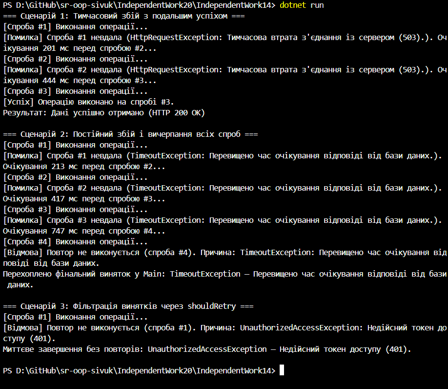

# Самостійна робота №20 — Реалізація Exponential Backoff

## Структура проєкту
- `RetryPolicy.cs` — власний узагальнений клас політики повторних спроб із підтримкою експоненційної затримки (`Math.Pow(2, retryAttempt)`), випадкового відхилення (`jitterFactor`), логування кожної спроби та фільтрації винятків через делегат `shouldRetry`.
- `Program.cs` — демонстрація роботи `RetryPolicy` у трьох сценаріях: успішне відновлення після тимчасових збоїв, вичерпання всіх спроб із прокиданням фінального винятку та миттєва відмова для нетимчасових помилок.

---

## Приклад виводу програми

---

## Висновок щодо меж застосування патерну Retry з Exponential Backoff

Патерн **Retry з експоненційною затримкою та Jitter** є ефективним засобом підвищення відмовостійкості, проте його застосування має чіткі межі:

1. **Ефективний лише для тимчасових (transient) збоїв:** патерн доцільний при короткочасній втраті мережевого зв'язку, таймаутах, блокуваннях рядків у базі даних або перевантаженні зовнішнього API (`429 Too Many Requests`, `503 Service Unavailable`). Якщо помилка спричинена багом у коді, невалідними даними або відсутністю прав доступу (`400`, `401`, `404`), повторні спроби не мають сенсу і лише затримують відповідь користувачеві.
2. **Не підходить для тривалих збоїв сервісу:** якщо зовнішній вузол повністю вийшов з ладу на кілька хвилин чи годин, експоненційні повтори лише утримують потоки застосунку в режимі очікування. У таких випадках `Retry` потрібно обмежувати невеликою кількістю спроб (`2–4`) і поєднувати з патерном **Circuit Breaker**.
3. **Вимога ідемпотентності операцій:** автоматичний повтор можна безпечно застосовувати лише до операцій, багаторазове виконання яких не спотворює стан системи (наприклад, читання даних `GET` або запити зі спеціальним ключем ідемпотентності).
4. **Обмеження на критичних до затримок ділянках (Real-time / UI):** зростання затримок (`200 мс → 400 мс → 800 мс → 1600 мс`) може перевищити прийнятний час відгуку інтерфейсу, тому загальний час очікування необхідно обмежувати зовнішнім таймаутом.

---

## Відповіді на контрольні запитання

### 1. Чому експоненційна затримка зазвичай ефективніша за фіксовану для тимчасових збоїв?
- **Дає перевантаженому сервісу час на відновлення:** при фіксованій малій затримці клієнт продовжує надсилати запити з постійною частотою, не дозволяючи серверу розвантажити чергу або перезапустити служби. Експоненційне збільшення інтервалів (наприклад, $0.2\text{ с} \rightarrow 0.4\text{ с} \rightarrow 0.8\text{ с}$) поступово знижує тиск на проблемний вузол.
- **Баланс між швидкістю реакції та навантаженням:** якщо збій був миттєвим, перша повторна спроба відбувається дуже швидко; якщо ж проблема триває довше, інтервали автоматично розтягуються без марної витрати ресурсів.

### 2. Для чого потрібен `jitter` і як він зменшує ризик одночасних повторних спроб?
Коли зовнішній сервіс тимчасово відмовляє, сотні або тисячі клієнтів отримують помилку майже одночасно. Якщо всі вони використовують однакову детерміновану формулу `initialDelay * Math.Pow(2, retryAttempt)`, їхні повторні запити відбудуться в одні й ті самі моменти часу, створюючи хвилі пікового навантаження (**ефект «громового стада» / Thundering Herd**).
Параметр **`jitter`** додає до розрахованого часу випадкове відхилення (у нашій реалізації в межах $\pm 20\%$), завдяки чому повторні запити клієнтів рівномірно розподіляються в часі й не перевантажують сервер повторно.

### 3. Яку роль відіграє делегат `shouldRetry` у власній реалізації політики повторних спроб?
Делегат `Func<Exception, bool> shouldRetry` дозволяє відокремити **механіку повторних спроб** від **правил класифікації помилок**:
- Він перевіряє тип або властивості винятку (наприклад, HTTP-код статусу чи код помилки БД) і вирішує, чи є помилка тимчасовою (`true` — повторити спробу) або фатальною (`false` — негайно прокинути виняток далі).
- Завдяки цьому один і той самий екземпляр `RetryPolicy` можна гнучко адаптувати до різних сервісів без зміни коду самого класу.

### 4. У яких випадках повторна спроба не є безпечною та її слід заборонити?
1. **Неідемпотентні операції без захисту від дублювання:** повторне виконання операцій списання коштів із рахунку, оформлення замовлення або відправлення електронного листа (якщо сервер виконав запит, але відповідь загубилася по таймауту, повтор призведе до подвійного списання чи дубліката).
2. **Помилки бізнес-логіки та валідації:** некоректні вхідні дані (`ArgumentException`, `FormatException`), порушення обмежень цілісності даних або нестача коштів на балансі.
3. **Помилки автентифікації та авторизації:** недійсний пароль, прострочений токен або відсутність прав доступу (`UnauthorizedAccessException`, HTTP `401`/`403`).
4. **Критичні системні помилки:** нестача пам'яті (`OutOfMemoryException`) або пошкодження стану програми, де повторне виконання гарантовано не дасть результату.